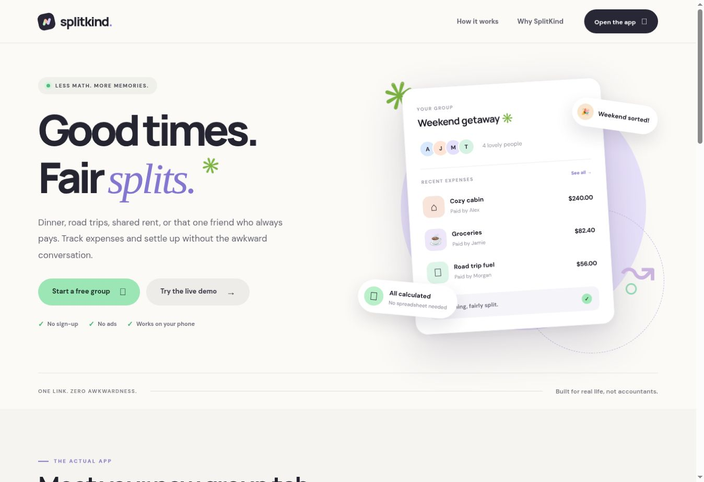

# ✳ SplitKind

**Good times. Fair splits.** A privacy-first Angular app for splitting real-life group expenses with no account, no ads, and no awkward math.



**[Launch SplitKind — public demo](https://splitkind.vercel.app)** · [Built by Samer Tallauze](https://samertall.com)

> Dinner with friends? A weekend trip? Sharing rent or utilities? Add your people, log what everyone paid for, and instantly see the simplest practical way to settle.

## What it does

- **Group expense tracking** — Add up to 50 people and 300 expenses per group.
- **Flexible participation** — Each expense can be split equally among any subset of people.
- **Precise calculation** — Integer minor-unit arithmetic avoids floating-point drift. Supports three decimal places for Jordanian dinars.
- **Settlement suggestions** — Balances are simplified into who should pay whom.
- **Share a snapshot** — A private-by-default group can be encoded into a shareable URL. No server-side storage.
- **Share settlement text** — Use the native share sheet or copy a simple summary for your group chat.
- **Export CSV** — Download the expense ledger for spreadsheets or records.
- **Automatic local saving** — Changes persist in the current browser using localStorage.
- **Responsive, accessible UI** — Works across desktop and mobile with labeled inputs and visible focus states.

## Quick start

Requires **Node.js 20.19+** and npm.

```bash
npm install
npm start
```

Open the localhost URL printed by Angular CLI.

Production build:

```bash
npm run build
```

The static production files are written to `dist/` and can be hosted on any static web host.

## How SplitKind handles money

1. Each expense is stored as an integer in the currency's smallest supported unit (cents; fils for JOD).
2. Equal shares are calculated using integer division; any remainder units are assigned deterministically in participant order.
3. Every person's balance is their payments minus their shares.
4. Debtors are paired with creditors to produce a practical settlement plan.

**Note:** The settlement plan does not process payments. Currency selection locks when a group has expenses, and there is no currency conversion.

## Privacy and sharing

No accounts or backend database are used. Your group is stored on your own device.

**Share links are encoded, not encrypted.** They contain participant names and expense amounts, and anyone with the link can read that snapshot. Links do **not** live-sync changes between devices. Use the text summary for a more limited share.

## Stack

- Angular 22, TypeScript 6, standalone components, signals, computed state
- HTML, SCSS, CSS Grid
- Browser localStorage, Web Share API, Clipboard API, Blob-based CSV export
- No external JavaScript UI libraries

## Roadmap

- Optional cloud-based collaborative groups with access control
- Per-person weighted and itemized splitting
- Receipt OCR with consent and private processing
- Multiple languages and internationalization

## License

MIT — see [LICENSE](LICENSE).

Built by [Samer Tallauze](https://samertall.com).
